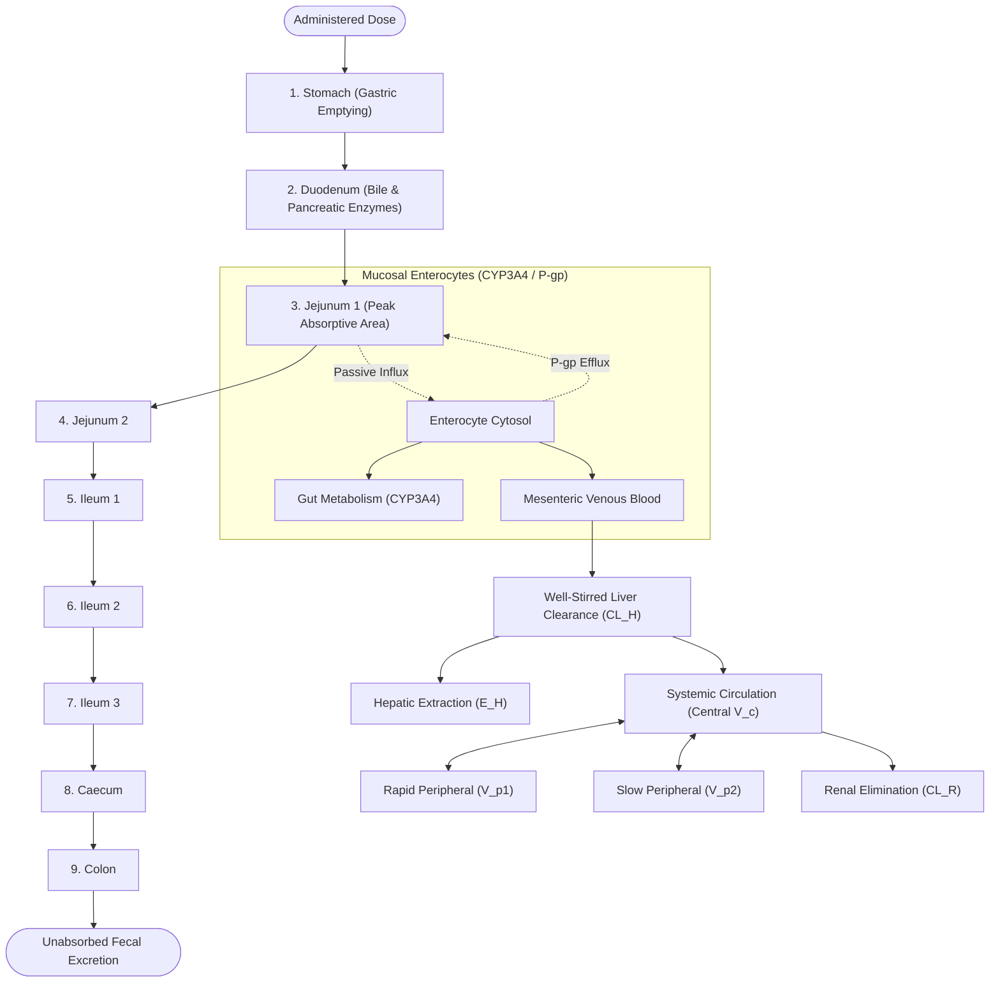

# GastroFlux.jl

<p align="center">
  <strong>Advanced Compartmental Absorption & Transit (ACAT) Engine & Physiologically-Based Biopharmaceutics Simulator in Julia</strong>
</p>

<p align="center">
  <a href="https://github.com/ZengLLQ/gastro-flux/actions"></a>
  
  
  
  
</p>

---

## 🔬 Overview

**GastroFlux** is a high-performance computational biopharmaceutics and physiologically-based pharmacokinetic (PBPK) simulation platform implemented in pure **Julia**. It models the oral absorption, gastrointestinal transit, dynamic dissolution, enterocyte metabolism, active efflux, and whole-body systemic disposition of small-molecule pharmaceutical compounds from first principles.

### Key Capabilities
- **9-Segment Anatomical GI Model:** Stomach, Duodenum, Jejunum 1 & 2, Ileum 1, 2 & 3, Caecum, and Colon with distinct luminal volumes, transit kinetics, pH gradients, bile salt concentrations, and mucosal surface area enlargement factors.
- **Dynamic Dissolution Kinetics:** Modified Noyes-Whitney / Nernst-Brunner equations coupled with Hixson-Crowell cube-root shrinking sphere particle dynamics and Hintz-Johnson hydrodynamic boundary layer scaling.
- **Microclimate & Micellar Thermodynamics:** Henderson-Hasselbalch ionization equilibria across arbitrary compound ionization profiles (weak acids, weak bases, ampholytes, and neutrals) coupled with bile-salt micellar solubilization.
- **Active Transporters & First-Pass Metabolism:** Michaelis-Menten apical P-glycoprotein (ABCB1) efflux transport, enterocyte CYP3A4 metabolic extraction, and well-stirred hepatic organ clearance.
- **Adaptive Numerical Solvers:** Embedded Dormand-Prince 5(4) (RK45) with continuous $C^1$ cubic Hermite polynomial dense interpolation and an L-stable second-order Rosenbrock (ROS2) stiff ODE integrator with analytical Jacobian factorizations.
- **Biopharmaceutical Classification System (BCS):** Automated calculation of microscopic dimensionless numbers (Dose Number $D_0$, Dissolution Number $Dn$, Absorption Number $An$) and non-compartmental pharmacokinetic (NCA) parameters ($C_{max}$, $t_{max}$, $AUC_{0-\infty}$, $MRT$, $CL/F$, $V_z/F$).

---

## 📐 Mathematical Formulation

### 1. Dynamic Dissolution & Particle Shrinkage (Noyes-Whitney / Hixson-Crowell)
The mass transfer rate of drug dissolving into luminal fluid is governed by the Nernst-Brunner equation:
$$\frac{dM_{diss, i}}{dt} = \frac{D_{eff}}{\delta_{eff, i}} \cdot A_{solid, i}(t) \cdot \left( S_{lum, i} - C_{diss, i} \right)$$

Under the Hixson-Crowell shrinking sphere assumption for monodisperse crystals of density $\rho$ and initial radius $r_0$:
$$r_i(t) = r_0 \left( \frac{M_{solid, i}(t)}{M_{dose}} \right)^{1/3}$$
$$A_{solid, i}(t) = \frac{3 \cdot M_{solid, i}(t)}{\rho \cdot r_i(t)}$$

The hydrodynamic diffusion layer thickness $\delta_{eff}$ obeys the Hintz-Johnson model:
$$\delta_{eff, i} = \min(r_i(t), \delta_0), \quad \delta_0 \approx 30\,\mu\text{m}$$

### 2. Ionization & Bile Micelle Partitioning
For weak acids and bases, aqueous solubility $S_{aq}(pH)$ is evaluated via Henderson-Hasselbalch equilibria:
$$\text{Weak Acid: } S_{aq}(pH) = S_0 \left(1 + 10^{pH - pK_a}\right)$$
$$\text{Weak Base: } S_{aq}(pH) = S_0 \left(1 + 10^{pK_a - pH}\right)$$
$$\text{Ampholyte: } S_{aq}(pH) = S_0 \left(1 + 10^{pK_{a,1} - pH} + 10^{pH - pK_{a,2}}\right)$$

Luminal solubilization enhancement by bile salts ($[BS]$ in mM):
$$S_{lum, i} = S_{aq}(pH_i) \cdot \left(1 + K_{mic} \cdot [BS]_i\right)$$

### 3. Enterocyte Mass Transfer, Active Efflux & Gut Metabolism
Within each gastrointestinal segment $i$, the enterocyte drug mass $M_{ent, i}$ satisfies:
$$\frac{dM_{ent, i}}{dt} = J_{perm, i} - J_{efflux, i} - R_{gut\_met, i} - J_{portal, i}$$
where:
$$J_{perm, i} = P_{eff, jej} \cdot \alpha_i \cdot A_{mucosal, i} \cdot C_{diss, i}$$
$$J_{efflux, i} = \frac{V_{max, Pgp} \cdot \theta_{Pgp, i} \cdot C_{ent, i} \cdot f_{u, gut}}{K_{m, Pgp} + C_{ent, i} \cdot f_{u, gut}}$$
$$R_{gut\_met, i} = \frac{V_{max, CYP} \cdot \theta_{CYP, i} \cdot C_{ent, i} \cdot f_{u, gut}}{K_{m, CYP} + C_{ent, i} \cdot f_{u, gut}}$$
$$J_{portal, i} = k_{basolateral} \cdot M_{ent, i}$$

### 4. Hepatic Clearance & First-Pass Extraction
Hepatic first-pass escape fraction $F_h$ is derived from the well-stirred liver model:
$$CL_H = \frac{Q_H \cdot f_{u, p} \cdot CL_{int, H} / R_b}{Q_H + f_{u, p} \cdot CL_{int, H} / R_b}$$
$$E_H = \frac{CL_H}{Q_H}, \quad F_H = 1 - E_H$$

Overall oral bioavailability $F$ is decomposed into:
$$F = F_a \cdot F_g \cdot F_h$$
where $F_a$ is the fraction absorbed from lumen to enterocytes, and $F_g$ is the fraction escaping intestinal CYP3A4 extraction.

### 5. Amidon Dimensionless Transport Numbers (BCS)
$$D_0 = \frac{M_{dose}}{V_0 \cdot S_{min}} \quad (V_0 = 250\,\text{mL})$$
$$An = \frac{P_{eff}}{R_{lumen}} \cdot \tau_{res} \quad (R_{lumen} \approx 1.0\,\text{cm})$$
$$Dn = \frac{D_{eff}}{\delta_{eff}} \cdot \frac{S_{min}}{\rho \cdot r_0} \cdot \tau_{res}$$

---

## 🔄 Physiological Architecture



---

## 📦 Project Structure

```
GastroFlux/
├── Project.toml                 # Package definition & standard library dependencies
├── LICENSE                      # MIT License
├── README.md                    # Scientific documentation, LaTeX equations & guide
├── src/
│   ├── GastroFlux.jl            # Main module exports & sub-module orchestration
│   ├── types.jl                 # Compound, Formulation, Physiology & Result structs
│   ├── solvers/
│   │   ├── solvers.jl           # Abstract solver interface & solution containers
│   │   ├── rk45.jl              # Adaptive Dormand-Prince 5(4) with cubic Hermite dense output
│   │   └── rosenbrock.jl        # L-stable ROS2 stiff solver with numerical Jacobian
│   ├── biopharmaceutics/
│   │   ├── solubility.jl        # Henderson-Hasselbalch & bile micelle partitioning
│   │   ├── dissolution.jl       # Noyes-Whitney, Nernst-Brunner & Hixson-Crowell kinetics
│   │   ├── precipitation.jl     # Nucleation driving force & supersaturation dynamics
│   │   └── permeability.jl      # Mucosal effective surface area & clearance scaling
│   ├── physiology/
│   │   ├── segments.jl          # 9-compartment GI tract anatomy (Fasted & Fed states)
│   │   ├── transporters.jl      # Apical P-glycoprotein (ABCB1) active efflux
│   │   └── metabolism.jl        # Gut-wall CYP3A4 & well-stirred hepatic disposition
│   ├── models/
│   │   ├── acat.jl              # 44-state coupled ACAT-PBPK ODE vector field
│   │   └── pbpk.jl              # Whole-body simulation runner & trajectory extractor
│   └── analysis/
│       ├── bcs.jl               # Biopharmaceutical Classification System diagnostic
│       ├── nca.jl               # Non-compartmental pharmacokinetic analysis (NCA)
│       └── sensitivity.jl       # Particle engineering & food-effect scanners
├── test/
│   ├── runtests.jl              # Comprehensive test suite runner
│   ├── test_solvers.jl          # Numerical ODE solver accuracy & stiff benchmarks
│   ├── test_solubility.jl       # Ionization equilibria & micellar solubilization
│   ├── test_dissolution.jl      # Particle geometry shrinkage & saturation checks
│   ├── test_physiology.jl       # Anatomical transit, transporters & liver clearances
│   ├── test_acat_pbpk.jl        # Complete ACAT-PBPK integration & mass conservation
│   └── test_bcs_nca.jl          # BCS classification, NCA & formulation sensitivity
└── examples/
    ├── bcs_class_benchmark.jl   # Comparative evaluation of BCS Class I, II, III, IV drugs
    ├── fed_vs_fasted.jl         # Food effect on weak base bioavailability
    └── formulation_optimization.jl # Particle micronization impact on dissolution rate
```

---

## 🚀 Quick Start

### Installation

Clone the repository and instantiate the project in Julia:

```bash
git clone https://github.com/ZengLLQ/gastro-flux.git
cd gastro-flux
julia --project=. -e "using Pkg; Pkg.instantiate()"
```

### Basic Simulation Example

```julia
using GastroFlux

# 1. Define drug physicochemical properties (BCS Class II Model)
drug = DrugProperties(
    name = "Ibuprofen-like",
    molecular_weight = 206.29,
    compound_type = :Acid,
    pKa1 = 4.4,
    intrinsic_solubility = 0.04,   # mg/mL (sparingly soluble)
    peff_jej = 3.2e-4,             # cm/s (highly permeable)
    fraction_unbound_plasma = 0.01,
    hepatic_clearance_int = 35.0,  # L/h
    renal_clearance = 0.5          # L/h
)

# 2. Define pharmaceutical formulation
form = Formulation(
    dose_mg = 200.0,
    particle_radius_um = 20.0,
    precipitation_rate = 0.3
)

# 3. Create human gastrointestinal physiology (Fasted state)
phys = create_human_physiology(state = :Fasted)

# 4. Classify drug under BCS
bcs = classify_bcs(drug, form)
println("BCS Classification: $(bcs.bcs_class) (D0 = $(round(bcs.dose_number, digits=2)), An = $(round(bcs.absorption_number, digits=2)))")

# 5. Execute 24-hour ACAT-PBPK dynamic simulation
result = simulate_absorption(drug, form, phys; t_end = 24.0)

println("Oral Bioavailability (F): $(round(result.bioavailability * 100, digits=1))%")
println("Fraction Absorbed (Fa):   $(round(result.fraction_absorbed * 100, digits=1))%")
println("Peak Plasma Conc (Cmax):  $(round(result.cmax, digits=2)) mg/L at $(round(result.tmax, digits=2)) h")
println("Total Exposure (AUC0-t):  $(round(result.auc_0_t, digits=2)) mg*h/L")
```

---

## 🧪 Testing

The repository contains 102 unit and integration tests verifying numerical convergence, mass conservation, physical chemistry limits, and physiological parameters.

```bash
julia --project=. test/runtests.jl
```

---

## 📜 References

1. **Amidon, G. L., Lennernäs, H., Shah, V. P., & Crison, J. R.** (1995). A theoretical basis for a biopharmaceutic drug classification: the correlation of in vitro drug product dissolution and in vivo bioavailability. *Pharmaceutical Research*, 12(3), 413-420.
2. **Yu, L. X., Crison, J. R., & Amidon, G. L.** (1999). Compartmental absorption and transit model for estimating oral drug absorption. *International Journal of Pharmaceutics*, 186(2), 119-125.
3. **Hintz, R. J., & Johnson, K. C.** (1989). The effect of particle size distribution on dissolution rate. *International Journal of Pharmaceutics*, 51(1), 9-17.
4. **Sugano, K.** (2009). Biopharmaceutics modeling and simulations for oral drug absorption. *Expert Opinion on Drug Metabolism & Toxicology*, 5(3), 259-293.
5. **Rowland, M., & Tozer, T. N.** (2011). *Clinical Pharmacokinetics and Pharmacodynamics: Concepts and Applications* (4th ed.). Lippincott Williams & Wilkins.

---

## 📄 License

This project is licensed under the MIT License - see the [LICENSE](LICENSE) file for details.
